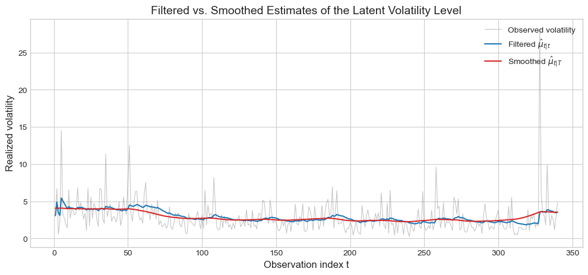
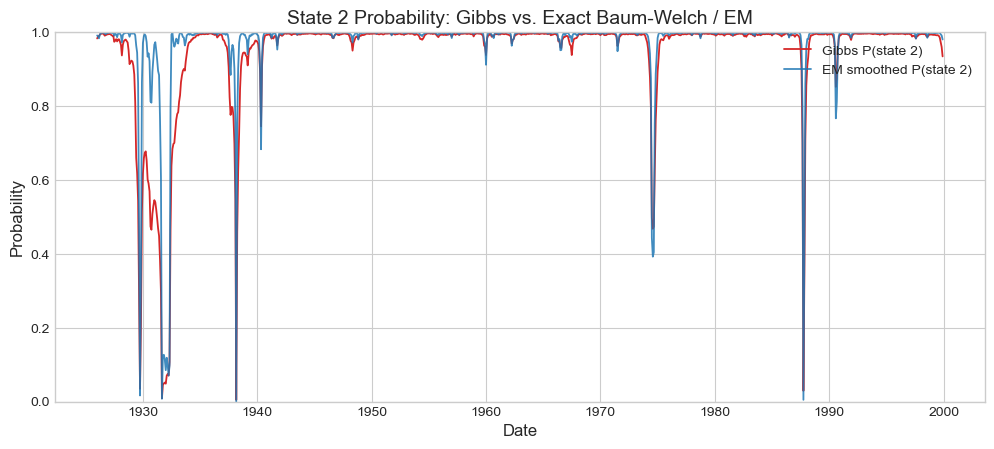
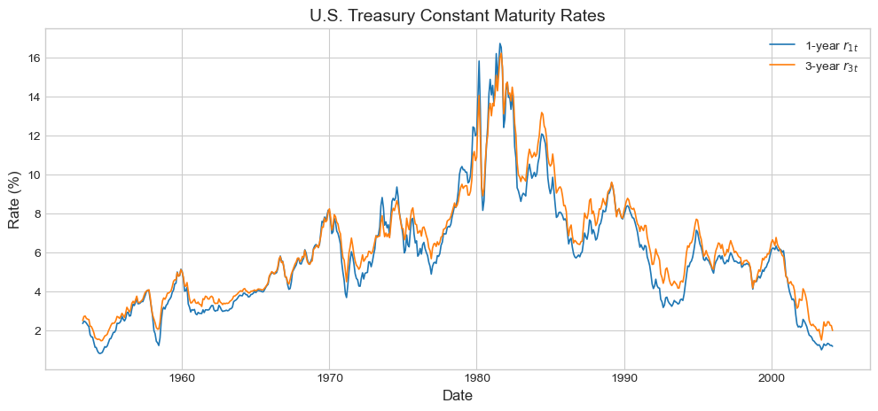
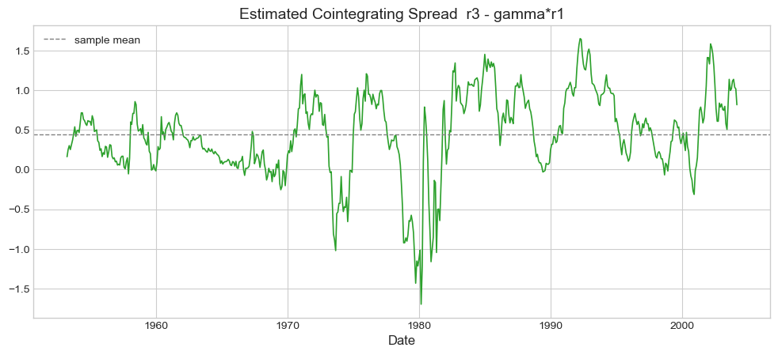

# Final: State-Space and Financial Time Series

This project covers three topics in time-series econometrics:

1. **Alcoa realized volatility:** estimate a local-level model with the Kalman filter and compare filtered with smoothed state estimates.
2. **GE monthly returns:** estimate a two-state Markov-switching GARCH model using Gibbs sampling, then compare state probabilities with Baum–Welch/EM.
3. **U.S. Treasury rates:** fit and diagnose VAR models for one-year and three-year rates, then test for cointegration with Johansen and Engle–Granger procedures.

## Project files

- `analysis.ipynb` is the complete notebook for Problems 1–3.
- `data/` contains the three input datasets required to reproduce the analysis.
- `figures/` holds a small selection of results from the notebook.

## Selected results

## Run

Install dependencies from the repository root, change into this directory, then open `analysis.ipynb` in Jupyter Lab. The Gibbs sampler is computationally intensive. It writes reusable draws to `.cache/`, which Git ignores; the cache is regenerated when absent.

## Data and interpretation

The bundled input files are the datasets supplied with the course project. The VAR residual whiteness and cointegration results depend on lag and deterministic-term choices; the notebook reports these checks and their sensitivity. The Markov-switching model section documents its modeling assumptions and sampling diagnostics.
