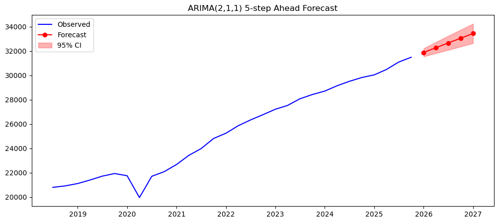
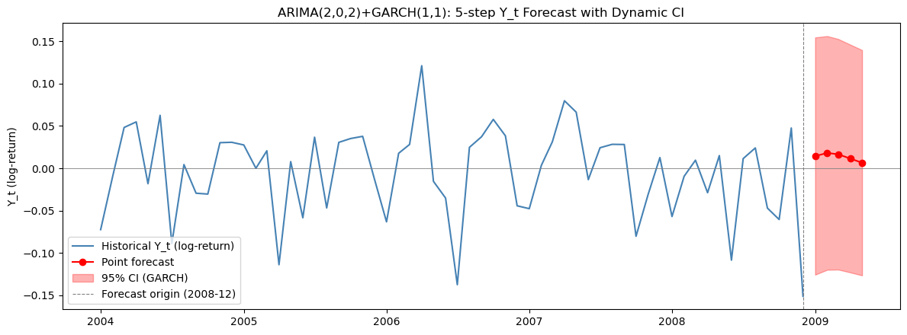
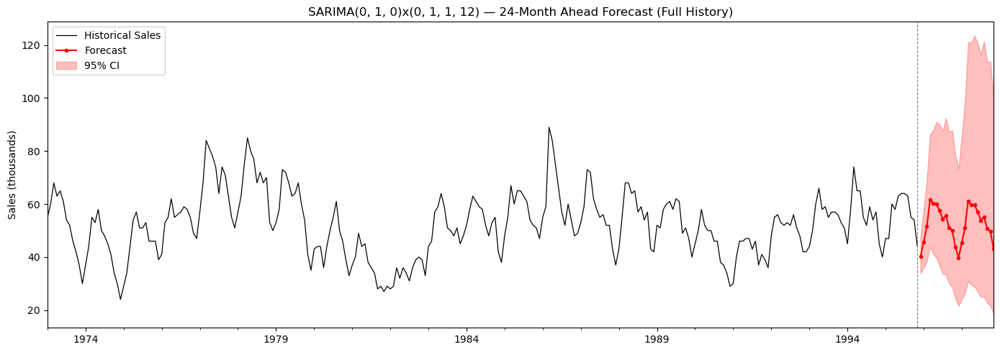

# Midterm: Time Series Forecasting

This project studies three forecasting problems using course-provided datasets:

1. **U.S. GDP:** assess integration, choose an ARIMA order, check residuals, and forecast the next five quarters.
2. **Three-month financial returns:** test for ARCH effects, fit a GARCH volatility model, check standardized residuals, and produce five-step forecasts.
3. **Monthly housing sales:** inspect trend and seasonality, select a seasonal ARIMA specification, and forecast 24 months.

## Project files

- `analysis.ipynb` contains the analysis for all three problems.
- `data/` contains the three input datasets required by the notebook.
- `figures/` contains the GDP, return, and housing-sales forecast plots.

The written analysis reports ARIMA(2,1,1) for GDP and describes the diagnostics and forecast uncertainty for each problem. See the notebook for model selection and full results.

## Run

From this directory, open `analysis.ipynb` in Jupyter Lab. Install the dependencies listed in the repository root's `requirements.txt` first.

## Data

The bundled input files are the datasets supplied with the course project. Their filenames have been normalized for readability; the source values are unchanged.

## Forecast figures

